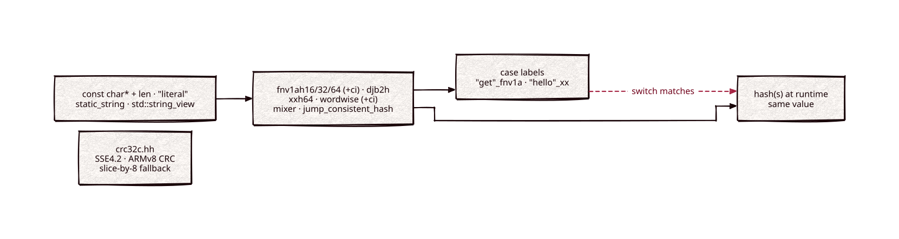

# hashes

Part of [Kronuz C++ Libraries](https://github.com/Kronuz/cpp-libraries), a collection of small, reusable C++ libraries.

[](https://github.com/Kronuz/hashes/actions/workflows/ci.yml)
[](LICENSE)


`constexpr` string hashing for C++20, so a `switch` over a runtime string can use
compile-time `case` labels. For dispatch on keywords and commands without string
compares. (CRC-32C moved to [crc32c](https://github.com/Kronuz/crc32c).)



## ✨ Highlights

- **String switches.** Hash at compile time for the `case` labels and at runtime
  for the input; the values match.
- **Many families, one interface.** FNV-1a (16, 32, 64, case-insensitive), djb2,
  a `constexpr` xxHash-64, and `wordwise`, a word-at-a-time hash that wins string
  dispatch on every real key set measured.
- **Every string form.** `const char*` and length, literals, `static_string`,
  `std::string`, `std::string_view`.
- **Integer tools.** `mixer` scrambles integers; `jump_consistent_hash` buckets
  keys.
- **xxHash optional.** A runtime xxHash fast path switches on when `xxhash.h` is
  on the include path.

## 📦 Installation

Requires a C++20 compiler and CMake 3.14 or newer. It fetches
[static-string](https://github.com/Kronuz/static-string) and
[char-classify](https://github.com/Kronuz/char-classify) at pinned commits. CI
builds it on Linux (x86_64, arm64), macOS (arm64, x86_64), and FreeBSD, plus ASan,
UBSan, and TSan builds.

```cmake
include(FetchContent)
FetchContent_Declare(hashes
  GIT_REPOSITORY https://github.com/Kronuz/hashes.git
  GIT_TAG        main)
FetchContent_MakeAvailable(hashes)

target_link_libraries(my_app PRIVATE hashes::hashes)
```

## 🚀 Quick start

```cpp
#include "hashes.hh"

#include <string_view>

int method(std::string_view s) {
	switch (fnv1ah32::hash(s)) {
		case fnv1ah32::hash("GET"):    return 1;   // compile-time labels
		case fnv1ah32::hash("PUT"):    return 2;
		case fnv1ah32::hash("DELETE"): return 3;
		default:                       return 0;
	}
}
```

[`examples/demo.cc`](examples/demo.cc) runs one word through every family and
shows `jump_consistent_hash` placing a key as buckets grow.

## 🎯 When to use it

- ✅ Dispatch on a fixed set of strings, alone or in front of
  [constexpr-phf](https://github.com/Kronuz/constexpr-phf) for a dense jump table.
- ❌ Passwords, signatures, or anything adversarial: none of these hashes is
  cryptographic.

## ⚡ Performance

String-dispatch keys are short, and there `wordwise` is the cheapest family: on an Apple M4 Pro
it hashes 4 to 24 bytes in 0.8 to 1.4 ns, ahead of XXH3 (1.3 to 1.8 ns) except at 12 bytes. Above 32 bytes its
word-at-a-time loop falls behind XXH3, by 1.3x at 64 bytes and 9x at 128 KiB. The self-contained
`xxh64` runs within 17% of xxHash's `XXH64`. ns per hash, one thread, best of two runs:

| bytes | `xxh64` | `XXH64` | `XXH3` | `absl::Hash` | `wordwise` |
| ---: | ---: | ---: | ---: | ---: | ---: |
| 4 | 1.29 | 1.10 | 1.28 | 0.55 | 0.76 |
| 16 | 1.74 | 1.72 | 1.27 | 0.51 | 1.08 |
| 64 | 4.69 | 4.68 | 2.62 | 1.29 | 3.38 |
| 1024 | 41.3 | 40.6 | 21.4 | 7.9 | 147 |
| 131072 | 5447 | 5458 | 2786 | 2128 | 24946 |

Apple M4 Pro, Apple clang 17 with `-O3`; xxHash v0.8.4 and abseil 20260817. Every row, the
Intel i9-9980HK numbers and a wide-lane candidate are in
[docs/BENCHMARKS.md](docs/BENCHMARKS.md). Run it with:

```sh
cmake -B build -DCMAKE_BUILD_TYPE=Release -DHASHES_BUILD_BENCH=ON
cmake --build build --target hashes_compare && ./build/hashes_compare
```

## 📚 Documentation

- [docs/API.md](docs/API.md): the families, the string switch, the literals and
  their quirks, and the xxHash seam.
- [docs/BENCHMARKS.md](docs/BENCHMARKS.md): which hash wins string dispatch, and the
  families against xxHash and absl.
- [ARCHITECTURE.md](ARCHITECTURE.md): how the families are built.
- [AGENTS.md](AGENTS.md): repository map, invariants, and traps.
- [CHANGELOG.md](CHANGELOG.md): dated changes.

## 🛠️ Building and testing

```sh
cmake -B build && cmake --build build && ctest --test-dir build
./build/hashes_demo
```

## 🤝 Contributing

Issues and pull requests are welcome. Hash values are part of the API (call sites
store them), so a change must keep every existing value; read
[AGENTS.md](AGENTS.md) first. CI must pass on every platform.

## 📄 License

MIT. `hashes.hh` is Copyright (c) 2015-2019 Dubalu LLC, with portions Copyright
(c) 2015 Daniel Kirchner.
See [LICENSE](LICENSE) and each file's header. Extracted from
[Xapiand](https://github.com/Kronuz/Xapiand).
